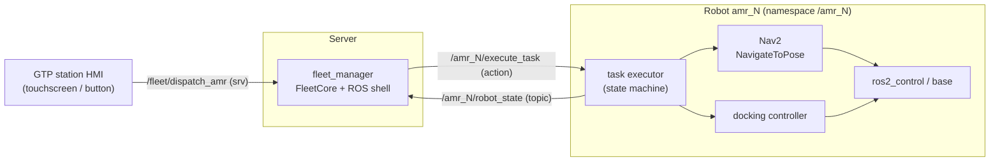
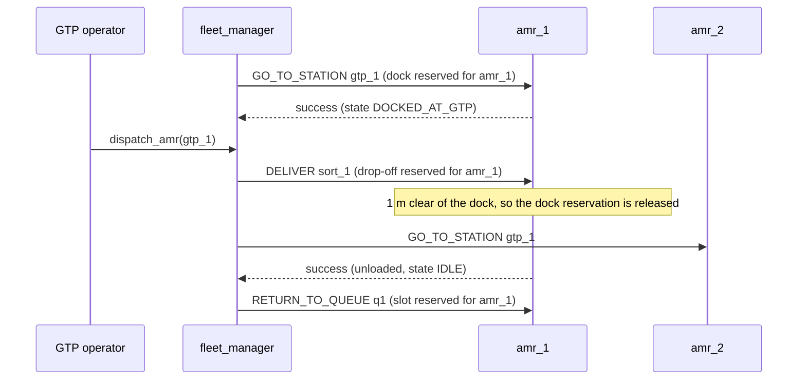

# Architecture

## 1. Who does what

- The **fleet manager** decides *who goes where and when*. It never touches Nav2,
  the map or the motors.
- The robot's **task executor** decides *how* to do one leg (undock, plan, drive,
  dock, wait for the operator). `mock_amr` stands in for it until it exists.
- One action goal = one leg of the cycle (`GO_TO_STATION`, `DELIVER`,
  `RETURN_TO_QUEUE`). Short goals keep the fleet manager in control between legs,
  so it can choose the return slot at the moment the robot actually needs it.

## 2. The GTP cycle

## 3. Robot states (`RobotState.state`)

| Value | State | Meaning |
|---|---|---|
| 1 | `IDLE` | Parked in a queue slot with no task |
| 2 | `TO_GTP` | Driving to a GTP dock, including the final precision docking |
| 3 | `DOCKED_AT_GTP` | Aligned beside the station, waiting for the operator |
| 4 | `LOADING` | The operator is loading items |
| 5 | `IN_TRANSIT` | Driving loaded to a drop-off |
| 6 | `UNLOADING` | At the drop-off, waiting for the worker |
| 7 | `RETURNING` | Driving empty to a queue slot |
| 0 / 8 | `UNKNOWN` / `ERROR` | Not reported yet / needs a human |

`TO_GTP` was added to the requested six states because the robot has to get from the
queue to the station somehow. `UNKNOWN` and `ERROR` make failures visible instead of
silent. *Offline* is not a robot state: the fleet manager decides it when the
heartbeat stops.

## 4. Fleet manager design

**Functional core, thin ROS shell.** `fleet_core.py` has no ROS import. It takes
inputs (`update_robot`, `dispatch`, `on_task_*`, `tick`) and puts the tasks to send
in an outbox. `fleet_manager_node.py` only converts messages and sends goals. All the
allocation logic is tested with plain pytest in about 0.1 s.

**Single-threaded, never blocking.** Everything runs in one executor thread, so there
are no locks. Goals are sent with `send_goal_async()`, and their answers come back as
callbacks. The dispatch service answers immediately: "accepted" means the task was
created, not that the delivery is finished.

**Rules that prevent deadlocks around the station:**

1. *Exclusive reservations.* Every dock, drop-off and queue slot is a resource with
   at most one holder. A robot is only sent somewhere after it holds that place.
   Otherwise its task waits as `PENDING`, for example when a delivery waits for an
   occupied drop-off.
2. *Clearance before release.* A robot keeps the place it is leaving until it is more
   than `clearance_m` away. The next robot is not called into a dock that is still
   being vacated.
3. *Slots ≥ robots.* This is checked at startup. A robot that finishes a delivery
   always has a free slot, so a returning robot can never wait forever.
4. *Fail safe.* An offline or faulted robot keeps every reservation it holds.
   Nobody is sent into a place that it may still be blocking.

**Selection policy** (`selection_policy`): `nearest` (straight-line distance to the
dock, ties broken by idle time) or `longest_idle` (spreads wear and battery use evenly).
A better `nearest` would ask Nav2's `ComputePathToPose` for the real path length.

**Restart recovery.** When a robot reports in with no known task, the fleet manager
claims the slot or dock it is standing at (`match_tolerance_m`). An IDLE robot found
anywhere else is sent back to the queue.

## 5. ROS 2 distribution

| Distro | End of life | Verdict for a new project in late 2026 |
|---|---|---|
| Iron | Dec 2024 | Already end of life, do not use |
| Humble | May 2027 | Only if a hardware vendor forces it |
| **Jazzy** | May 2029 | Recommended for the robots |
| Lyrical | May 2031 | Fine (newest LTS, on Ubuntu 26.04) |

The code in this repository is tested on Jazzy and avoids APIs newer than Humble.
Jazzy and later also ship Nav2's docking server (`opennav_docking`), which is the
starting point for `amr_docking`.

## 6. Scaling from 3 to 10+ robots

- **Namespaces everywhere.** Each robot runs its full stack under `/amr_N`, including
  Nav2 with `/tf` → `tf` remapping, so robots never see each other's transforms.
- **Discovery across machines.** `ROS_AUTOMATIC_DISCOVERY_RANGE=LOCALHOST` is fine on
  one laptop but blocks a real fleet. Use `SUBNET` with a shared `ROS_DOMAIN_ID`.
  Past about 5 robots on Wi-Fi, switch to a Fast DDS discovery server or `rmw_zenoh`.
- **Traffic zones.** The reservation table already supports any named zone. Next,
  add the aisle in front of the GTP dock as a zone that a robot must hold to enter.
- **Open-RMF.** Once the fleet needs lifts, doors, mixed vendors or real path-level
  traffic negotiation, write an Open-RMF fleet adapter around the robots' `execute_task`
  instead of growing this fleet manager.

## 7. Known gaps (next steps)

- Robot-side task executor with a real state machine (deliverable 2).
- Precision docking controller (deliverable 4).
- If a robot reboots in the middle of a task, its goal is lost. Compare
  `RobotState.task_id` with the active task, and fail the task when they disagree for
  longer than the heartbeat timeout.
- No `reset_robot` service yet: a faulted robot is cleared by restarting the fleet
  manager, which then re-adopts every robot where it stands.
- No charging task: robots below `min_battery_percent` simply get no new work.
- Queue slots must be side-by-side bays. A single-file lane would need "move up"
  tasks.
- A `/fleet/state` topic for the HMI, for example to enable DISPATCH only when an AMR
  is docked.
